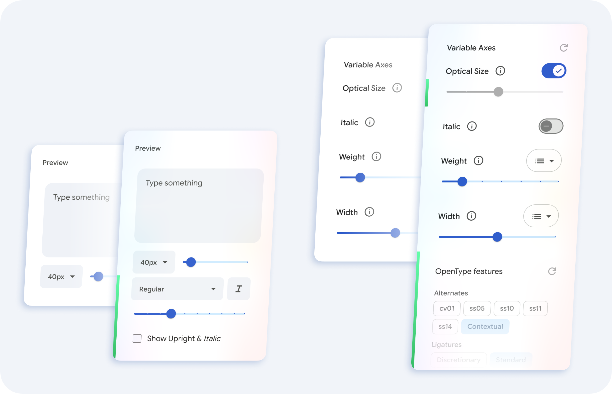

<h1 align="center">GF Boost</h1>

<a href="README.ru.md">Читать на русском</a> · <a href="CHANGELOG.md">Changelog</a>

A userscript for [Google Fonts](https://fonts.google.com/): adds italic and weight previews, Cyrillic quality ratings, OpenType features, and precise axis controls.

## Catalog

* **Italic:** *`I`* button and `I` hotkey. Dual-style view (`Show Upright & Italic`, `Shift+I`). Hold `Shift` and hover a card to preview italic.
* **Weight:** Picker and slider (100–1000). Hotkeys `W` / `Shift+W`.
* **Missing styles:** Grayed-out cards showing the closest available weight and style gaps. Optional kaomojis.
* **Cyrillic ratings:** Quality marks (good/so-so/bad) from "Cyrillic on Google Fonts" reviews on [type.today journal](https://type.today/journal) and from script authors.
* **Interface:** Collapsed Knowledge articles, icon-only layout toggles, reordered filters, and script settings reset via "Reset all".

## Font Pages

* **OpenType features:** Grouped toggles for alternates, ligatures, figures, case, and spacing, plus a language selector.
* **Optical size (`opsz`):** Manual or automatic slider with a logarithmic scale.
* **Axis stops:** Snap-to-stop magnetic behavior for named font instances.
* **Sticky preview:** Stays in view while scrolling settings. Proper `lang` attribute markup.

Try it on [Playfair](https://fonts.google.com/specimen/Playfair).

## URL Parameters

State syncs via the `gfb` parameter (e.g., `gfb=ri,700` or `gfb=o24,smcp,-liga`).

## Installation

1. Install a userscript manager ([Tampermonkey](https://www.tampermonkey.net/) or [Violentmonkey](https://violentmonkey.github.io/)).
2. Chrome: enable "Allow User Scripts" in extension details (`chrome://extensions`).
3. Open [gf-boost.user.js](https://github.com/Tranya/gf-boost/raw/main/gf-boost.user.js) and click **Install**.

The manager installs updates by itself.

**Requirements:** Chrome or Edge 111+, Firefox 121+.

## Plans

- A browser extension.
- Safari support.

## Contributing

Tell us what is missing in the script: [open an issue](https://github.com/Tranya/gf-boost/issues) and describe what you are trying to do. Pull requests with new features, improvements and fixes are welcome, and LLM-written PRs are welcome too. See [CONTRIBUTING.md](CONTRIBUTING.md).

## License

[GPL-3.0-or-later](LICENSE). Made by Dmitry Sivukhin, Rustam Mushraipov, Magomed Vagabov.
