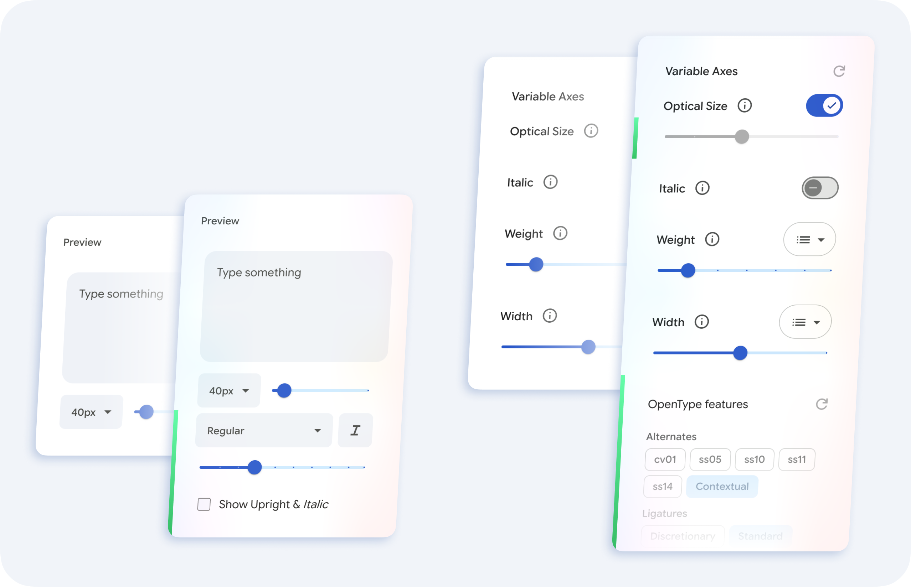

<h1 align="center">GF Boost</h1>

<a href="README.md">English version</a> · <a href="CHANGELOG.md">Список изменений</a>

Юзерскрипт для [Google Fonts](https://fonts.google.com/): расширяет каталог, добавляет курсив и вес для карточек, оценки кириллицы, OpenType-фичи и точную настройку осей.

## Каталог

* **Курсив:** кнопка *`I`* и горячая клавиша `I`. Режим «Upright & *Italic*» (`Shift+I`) показывает прямое и курсивное начертания вместе. `Shift` + наведение предпросматривает противоположное начертание в отдельной карточке.
* **Насыщенность:** выпадающий список и слайдер (100–1000). Горячие клавиши `W` / `Shift+W`.
* **Недостающие начертания:** серые карточки с указанием отсутствующего стиля и отключаемыми каомодзи.
* **Оценки кириллицы:** индикаторы качества (хорошо/так себе/плохо) по данным type.today и от авторов скрипта.
* **Интерфейс:** свёрнутые статьи Knowledge, иконки видов (Row/Grid/Sample), логичный порядок фильтров и сброс настроек скрипта через кнопку «Reset all».

## Страница шрифта

* **Фичи Опентайпа:** группировка работающих фич (альтернативы, лигатуры, цифры, регистр, интервалы) и выбор языка.
* **Оптический размер (`opsz`):** ручной или автоматический слайдер с логарифмической шкалой.
* **Фиксация осей:** примагничивание слайдеров к именованным начертаниям (стопам).
* **Превью:** фиксируется при прокрутке настроек. Корректный атрибут `lang`.

## Ссылки и параметры

Состояние сохраняется в URL через параметр `gfb` (например, `gfb=ri,700` или `gfb=o24,smcp,-liga`).

## Установка

1. Установите менеджер скриптов ([Tampermonkey](https://www.tampermonkey.net/) или [Violentmonkey](https://violentmonkey.github.io/)).
2. В Chrome включите «Разрешить пользовательские скрипты» (`chrome://extensions` → Сведения).
3. Откройте [gf-boost.user.js](https://github.com/Tranya/gf-boost/raw/main/gf-boost.user.js) и нажмите **Установить**.

Обновления менеджер ставит сам.

**Требования:** Chrome или Edge 111+, Firefox 121+. Скрипт рассчитан на компьютерную вёрстку сайта.

## В планах

- Расширение для браузера.
- Поддержка Safari.

## Участие

Предлагайте, чего не хватает в скрипте: [создайте ишью](https://github.com/Tranya/gf-boost/issues) и опишите задачу. Пулл-реквесты с новыми функциями, улучшениями и исправлениями приветствуются, в том числе написанные с помощью LLM. Подробности — в [CONTRIBUTING.md](CONTRIBUTING.md).

## Лицензия

[GPL-3.0-or-later](LICENSE). Авторы: Дмитрий Сивухин, Рустам Мушраипов, Магомед Вагабов.
